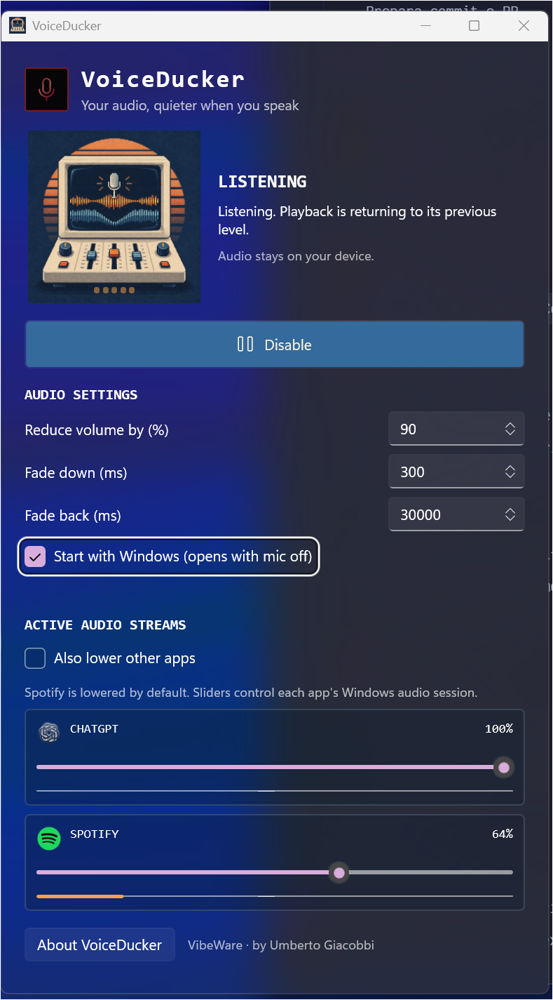

# VoiceDucker

**You talk. Music turns down. You stop. It comes back.**

I built VoiceDucker to talk to AI while Spotify keeps playing.
It can lower browser videos and other Windows apps too.

Useful for AI chats, Zoom or Teams calls, and demos or streams with
OBS Studio, Microsoft Clipchamp, or similar tools.

## A small personal note

No sales pitch here: now that I use VoiceDucker every day, I appreciate it more
than I expected. Chrome and Edge tabs apparently have a lot to say, and some
prefer to shout. I hadn't realised how much those interruptions broke my
concentration, especially with headphones on.

Having music, a video or a film turn down while I speak makes everyday PC use
feel much calmer. I still get the audio I want, with less of a fight for my
attention. It's a small convenience until you get used to it — then you miss it.
I'm glad I shared the app. If it makes other people's days a little less noisy
too, that's a good enough reason for me.

> [!IMPORTANT]
> **Windows on ARM testers wanted — volunteer guinea pigs welcome! 🐹**
>
> This is my hobby project. If you can try the
> Windows ARM64 build, I'd love your help checking microphone detection,
> audio ducking, and volume restoration. I'll give you all the support I can.
>
> **VoiceDucker currently runs on Windows only.** macOS and Linux would need
> ports. If you'd like to help with that work and
> eventually be a guinea pig there too, you're very welcome!
>
> [Open an issue](https://github.com/umbertotechnopreneur/VoiceDucker/issues)
> and tell me which platform you have and what worked or failed.

## What changed in 0.2.0

Since 0.1.1, I improved the audio engine and reviewed its resource handling:

- I now receive Windows volume and mute events, including while monitoring is off.
  My own mixer writes are identified separately from external changes.
- I improved fades and interrupted fades. Each session returns to the volume
  captured when the app opened; repeated cycles no longer lower that baseline.
- I release expired audio sessions during monitoring and unregister callbacks,
  stop timers and release audio resources when the app closes.
- I integrated the Store trial/license interface and fading footer links.
  Portable builds remain unrestricted and MIT-licensed.
- I corrected the WinGet packaging instructions and reviewed dependency scan
  evidence, microphone privacy, diagnostics and memory/resource lifetime.

See the [release notes](docs/releases/0.2.0.md) for details.

## Start here

1. On **Windows 11**, download a ZIP from [GitHub Releases](https://github.com/umbertotechnopreneur/VoiceDucker/releases).
   Choose **x64** for most PCs, or **ARM64** for Windows on ARM.
2. Extract the whole ZIP. Open `VoiceDucker.exe`. Keep the files together.
3. Play some music. Press **Enable**.
4. Speak. The music gets quieter. Pause, and it slowly comes back.

Press **Disable** to stop. The microphone always starts **off**.
The ZIP needs no installer; it is unsigned, so Windows may show a security prompt.

## Choose which apps get quieter

Spotify is included by default.

- Open **Settings > Apps & startup** and turn on **Also lower other apps** for browsers and other players.
- To leave an app alone, hover over its name and click the **X** (**Hide**).
- To bring it back, open **Hidden apps** and click its **X** (**Show**).

Hide your meeting app if you do not want its playback lowered.

## Need to change something?

Open **Settings**. Start with the defaults.

- Wrong mic? Choose it under **Microphone**.
- Not detecting your voice? Raise **Sensitivity**.
- Triggered by room noise? Raise **Detection threshold**.
- Music still too loud? Raise **Reduce volume by**.
- Music returns too soon? Raise **Wait before fade back**.

Leave the other settings alone until you need them.

Settings save automatically. The window remembers its size and position too.
MSIX updates keep these preferences. Uninstalling the MSIX removes its private
settings, so install a newer package over the existing one to keep them.

## Good to know

VoiceDucker reacts to microphone sound, not words. Opening a browser alone does
not lower audio. There are no recordings, transcription, or audio uploads.

For OBS or Clipchamp, make a short test recording first. VoiceDucker lowers
Windows playback; your recording's sound depends on its audio sources.

Opening VoiceDucker again shows the existing window, not a second copy.

At launch, VoiceDucker remembers each app audio session's volume in memory.
Every reduction and restoration uses that same baseline until VoiceDucker exits,
including after Disable/Enable or a mixer change. Sessions created later are
remembered when first detected. Muted and silent playback is left alone.
Windows volume and mute notifications are monitored even while the microphone
is off. VoiceDucker recognizes its own mixer writes separately from external
changes; external changes do not replace the startup baseline.

## For developers

[Build and debug](docs/DEVELOPMENT.md) · [Package and release](docs/RELEASING.md)

---

  

### This is VibeWare · [Manifesto](https://umbertogiacobbi.biz/vibeware/manifesto)

I created VoiceDucker with AI assistance. I define its purpose, guide the implementation, and take responsibility for checking functionality, performance, and security. VibeWare is my initiative for building useful software openly with AI; I ask you to judge the result and the evidence behind it.

To learn what VibeWare means and why I created it, read the [VibeWare manifesto](https://umbertogiacobbi.biz/vibeware/manifesto).

[VoiceDucker on GitHub](https://github.com/umbertotechnopreneur/VoiceDucker) · [VibeWare on GitHub](https://github.com/umbertotechnopreneur/VibeWare) · [umbertogiacobbi.biz](https://umbertogiacobbi.biz)

[Terms](https://umbertogiacobbi.biz/terms/) · [Privacy](https://umbertogiacobbi.biz/privacy/)

*You are welcome to explore, adapt and reuse the open-source VibeWare materials under the project license — my contribution to the developer community.*

The Microsoft Store edition uses the Store-managed 30-day trial and a one-time
purchase at the price shown for your market (base US price: $1.99). The trial
does not automatically charge you. Store license status and expiration govern
access; the app stops monitoring and restores audio it still owns if access ends.
Local development packages and the MIT portable distribution do not use Store
licensing. This does not change the source license.

## A note on security

I care about what goes into this project. Before I add a third-party library or prebuilt binary, including files supplied without source code, I scan the downloaded package, its extracted files and any dependencies with Microsoft Windows Defender. I keep new imports aside until the scan finishes without detections.

I keep a record of where each new import came from and the scan result. If a scan cannot finish or flags something, I leave it out.
